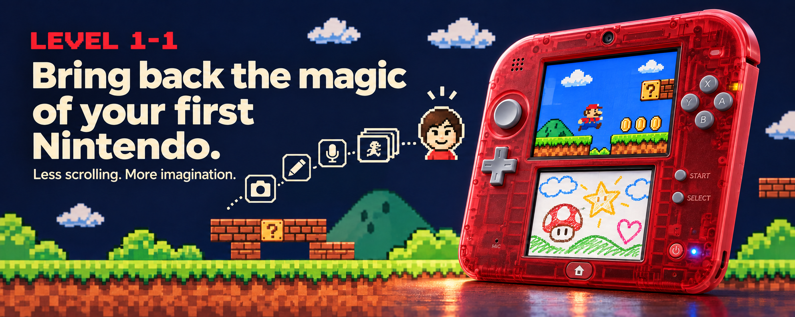

# Level 1-1

**Bring back the magic of your first Nintendo.**

Remember the jump you kept missing? Then you landed it and looked up. “Did you see that?”

Now it’s your kid calling you over. They beat a level, drew a monster, or recorded the voice it makes. Then they hand you the 2DS. “Here. You try.”

*Less scrolling. More imagination.*

Level 1-1 is an early-stage setup project for parents with the original wedge-shaped Nintendo 2DS. Pick a few games and creative tools your kid can use with Wi-Fi off. The curated picks will be screened for ads and in-app purchases.

## Gear for a used 2DS

- **Padded zip case.** Buy one shaped for the original 2DS, ideally with a divider to keep the charger and cartridges away from the screens.
- **Two screen protectors.** Get an original 2DS set and check stylus response across the lower screen after fitting it.
- **USB-C charging adapter.** Pick an external adapter that lists 2DS support and use the power supply its maker specifies. Keep the Nintendo charger for testing. [Hyperkin charging kit](https://wholesale.hyperkin.com/products/shockline-type-c-usb-power-supply-for-3ds-2ds-dsi-10w-5v) · [Nintendo charger](https://www.nintendo.com/us/store/products/ac-adapter-nintendo-2ds-nintendo-3ds-xl-nintendo-3ds-nintendo-dsi-xl-and-nintendo-dsi-82577/)
- **Spare stylus.** Get one that fits the original 2DS slot.
- **Circle Pad replacement, if needed.** Test every direction and check that the stick returns to center. Replace a worn or missing cap. For drift, calibrate first. Persistent drift or dead directions may call for a compatible joystick module. [iFixit original 2DS repair reference](https://www.ifixit.com/Device/Nintendo_2DS)

While you can still return it, check charging, battery life, the touchscreen, shoulder buttons, sleep switch, and cartridge slot.

## Set it up

[Start with the stock 2DS checklist](QUICKSTART.md) and try the handoff with Wi-Fi off.

1. **Start with what’s built in.** Use Nintendo 3DS Camera for photos and short videos, Nintendo 3DS Sound for recording, and Mii Maker for characters. Pick a few compatible DS or 3DS games you own or lawfully acquired. Use personal backups only where permitted. Level 1-1 will link to authorized homebrew releases and exclude commercial game downloads, BIOS files, title keys, and piracy sources. [Nintendo 2DS manual](https://csassets.nintendo.com/noaext/image/private/t_KA_PDF/manual-nintendo-2ds-operations-english)
2. **Add homebrew if you want it.** Follow the [optional drawing and animation setup](HOMEBREW.md) to try Junkdraw.
3. **Try it the way your kid will use it.** Turn Wi-Fi off, review parental controls and browser access, and launch each pick. Save and reopen a creation. Keep setup tools out of the way and decide together how photos and recordings get shared.

## Start a guided setup

Copy this prompt into an AI chat with web access.

```text
Guide me through setting up Junkdraw on an original wedge-shaped Nintendo 2DS.
Ask if I have the console in hand. If it hasn’t arrived, give me a short gear
checklist and stop there. If I have another model, pause and point me to the guide
for that model. I’ll handle the console and all SD card changes.

Ask for my full System Settings version (including region suffix), current screen,
and existing custom firmware state. If that state is unclear, use
https://3ds.hacks.guide/checking-for-cfw.html before picking a route.
Confirm the console is charged and I’ve backed up the full SD card before any
file or firmware changes. Keep recovery backups on my computer.

Use https://3ds.hacks.guide/ for firmware steps through Homebrew Launcher. Match
the live guide to my model, version, region, and firmware state. Give one action
at a time with the guide link, what I should see, and a question to confirm it.
Wait for my reply. If you can’t read the guide, ask me to open it and paste the
relevant step. If a screen differs or errors, pause and use
https://3ds.hacks.guide/troubleshooting.html.

Once Homebrew Launcher opens, have me download 3ds_junkdraw.3dsx from
https://github.com/randomouscrap98/3ds_junkdraw/releases/tag/0.5.2 on my computer.
With the 2DS powered off, copy it to /3ds/3ds_junkdraw.3dsx on the SD card.
Safely eject and reinsert the card, turn the console on, set Wireless
Communication to Off in HOME Menu Settings, and launch Junkdraw.

Guide me through drawing a ball with the stylus, using R + Up to make three
pages with the ball at different heights, and opening the Start menu to preview
the animation loop. Have me save as Ball test, close the app, reboot, confirm
wireless is still off, then reopen the save and play the loop. Report which
checks I confirmed and where to resume if I stop.
```

## What’s planned

1. **Test the basics on an original 2DS.** Write a short parent checklist for stock apps and cartridge play.
2. **Pilot Junkdraw on an original 2DS.** Verify offline drawing, animation, and saving and reopening work. Try an optional HOME Menu theme on supported consoles.
3. **Pilot setup with parents.** Try the [guided setup walkthrough](WALKTHROUGH.md) and the manual checklist. Publish v1 after families can repeat setup and open games and saved creations offline.

Level 1-1 is an independent project. Nintendo, Nintendo 2DS, and Mii are Nintendo marks.
